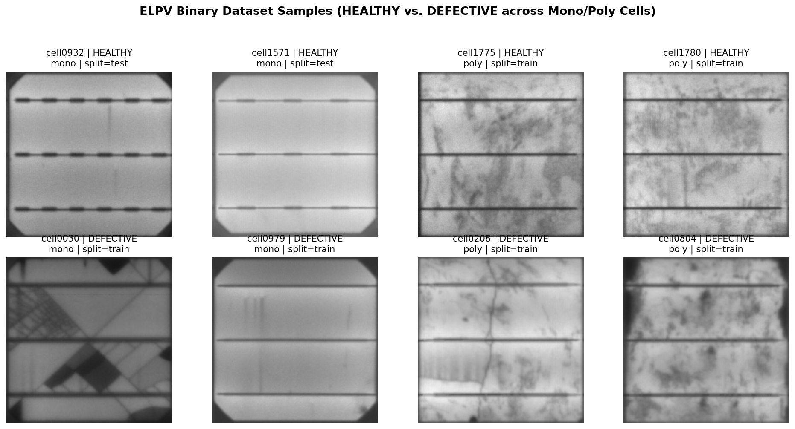
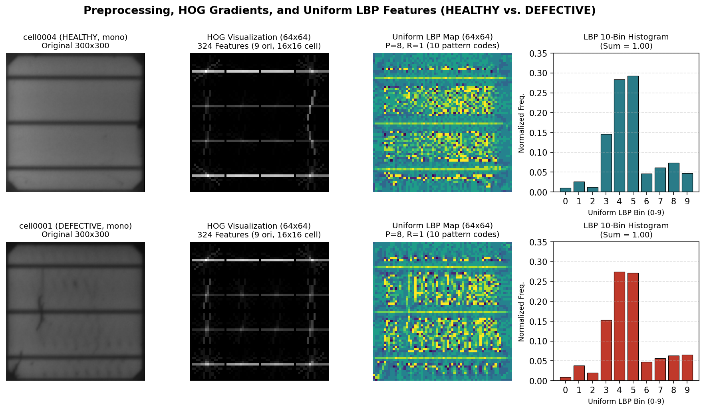
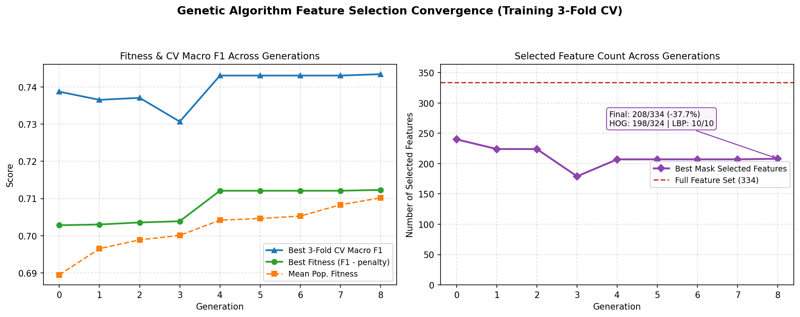
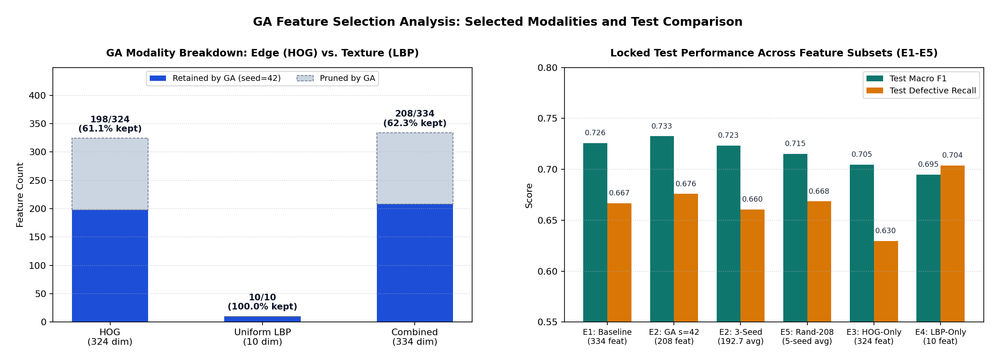
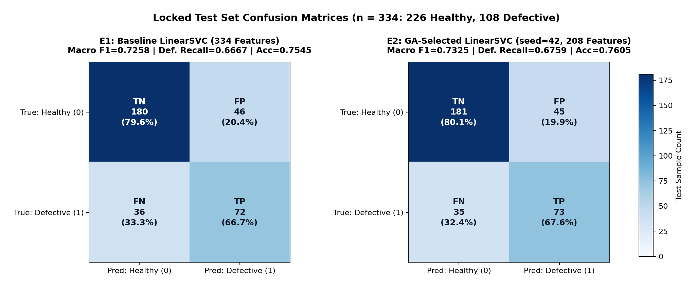
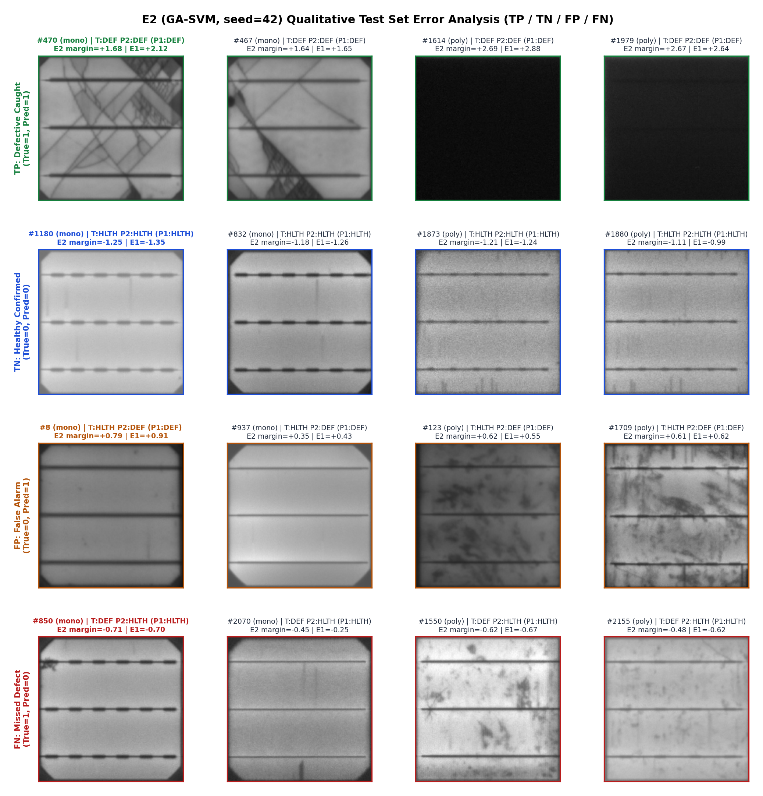
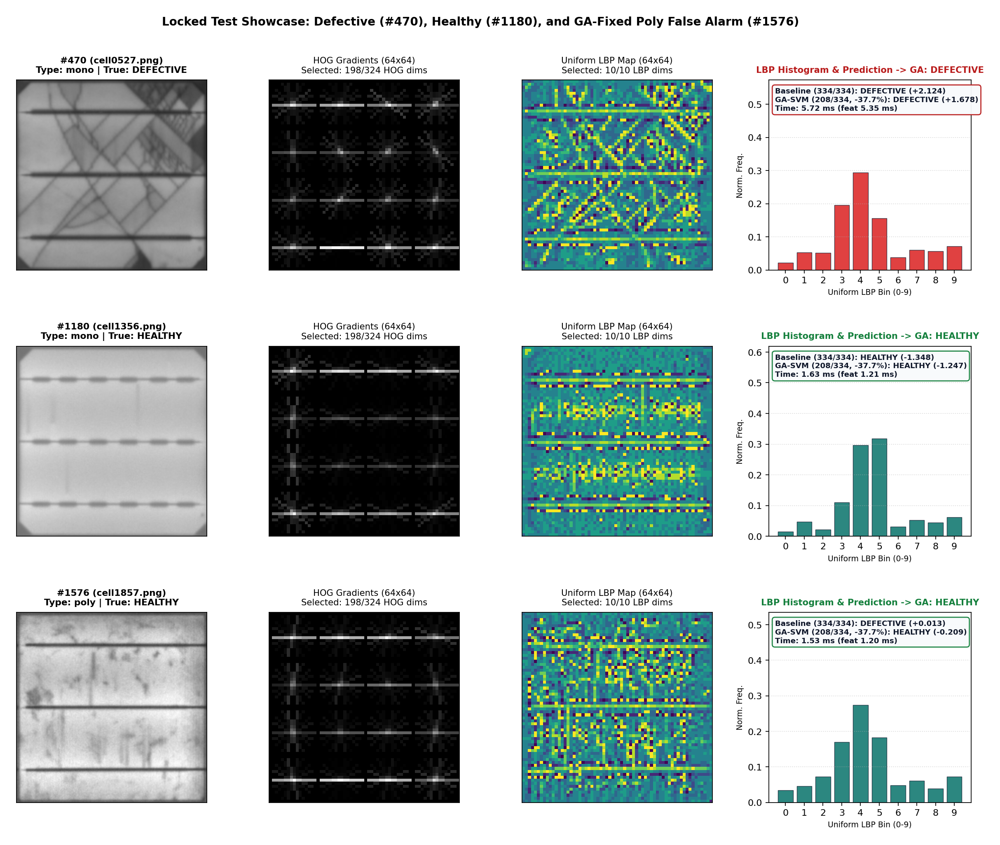

# Intelligent Solar Cell Defect Classification Using Genetic Algorithm-Based Feature Selection

**Course:** SENG435 — Introduction to Digital Image Processing  
**Instructor:** Assoc. Prof. Tuba ÇAĞLIKANTAR  
**Author:** Mertcan İLHAN — 22050911018  
**Submission Date:** December 2026  

---

## Abstract

Automated visual inspection of photovoltaic (PV) solar cells using electroluminescence (EL) imaging enables early detection of structural micro-cracks, finger interruptions, and electrically inactive regions that remain invisible under conventional visible-light photography. However, handcrafted local image descriptors often introduce high-dimensional redundancy and degrade generalization across heterogeneous monocrystalline and polycrystalline cell backgrounds. This study presents a reproducible classification and evolutionary feature-selection pipeline with a held-out cell-level test split evaluated on the public ELPV dataset. From the `2,624` raw grayscale EL cell images (`300 × 300`), we isolate the `2,223` definite binary-labeled instances (`1,508` HEALTHY, `715` DEFECTIVE) and partition them using joint stratification on class label and crystal type (`1,556` train, `333` validation, `334` locked test). Each cell is resized to `64 × 64` pixels and represented by a concatenated `334`-dimensional feature vector combining `324` Histogram of Oriented Gradients (HOG) structural descriptors and `10` normalized Uniform Local Binary Pattern (LBP) texture bins. A baseline `StandardScaler + LinearSVC` (`C = 0.001`, `class_weight="balanced"`) trained on all `334` features achieves a locked test Macro F1-score of `0.7258`, Defective Recall of `0.6667`, and Accuracy of `0.7545`. We formulate a binary-mask Genetic Algorithm (GA) wrapper optimized solely with 3-fold stratified cross-validation on the training split using a sparsity-regularized objective ($\text{Fitness}(m) = F_{1,\text{CV}}(m) - 0.05 \cdot \|m\|_1 / 334$). On the primary run (`seed = 42`), GA retains `208` of `334` features (`198/324` HOG and all `10/10` LBP bins, a `37.72%` reduction) while improving locked test Macro F1 to `0.7325`, Defective Recall to `0.6759`, and Accuracy to `0.7605`. Across three independent GA seeds (`42, 123, 999`), the wrapper removes `42.31% ± 9.82%` of features on average (`192.67 ± 32.81` dimensions) with a mean test Macro F1 of `0.7232 ± 0.0081`. On this split, combining HOG and LBP scored higher than either descriptor alone (`0.7045` HOG-only; `0.6949` LBP-only), and GA scored higher than the 208-feature random comparison (`0.7151` 5-seed mean). Subgroup error analysis further demonstrates that GA pruning lowers polycrystalline cell errors from `31.16%` (`62/199`) to `28.14%` (`56/199`), while transparently documenting remaining limitations on faint localized cracks and lack of module-level identifiers in bundled ELPV metadata.

**Keywords:** Solar Cell Defect Classification, Electroluminescence Imaging, Feature Selection, Genetic Algorithm, Histogram of Oriented Gradients (HOG), Local Binary Patterns (LBP), Support Vector Machine (SVM).

---

## 1. Introduction & Problem Definition

Photovoltaic (PV) solar modules are exposed to mechanical stress during manufacturing, transport, installation, and field operation, resulting in micro-cracks, broken busbars/fingers, and shunted or electrically inactive cell regions. Because silicon emits near-infrared electroluminescence (EL) radiation under forward bias current roughly proportional to local minority-carrier diffusion and electrical connectivity, defective areas appear dark or structurally disrupted in EL imagery even when invisible to standard RGB cameras [1, 2]. Consequently, EL imaging has become an industrial standard for non-destructive PV quality control.

Manual expert screening of thousands of individual solar cell EL crops is time-consuming, expensive, and subject to inter-observer inconsistency. Automated classical machine learning pipelines using domain-specific descriptors remain attractive for rapid quality assurance on CPU hardware because they are transparent, interpretable, and fast at inference time (`~1–2 ms` per cell). Nonetheless, extracting dense spatial gradient descriptors across resized cell patches creates hundreds of dimensions (`334` features in our baseline formulation), many of which primarily capture regular busbar geometry or benign polycrystalline grain contrast rather than defect signatures.

This study addresses the following concrete research question:

> *Can a Genetic Algorithm (GA) wrapper operating over concatenated HOG (edge/shape) and Uniform LBP (micro-texture) image descriptors reduce feature dimensionality relative to an all-feature Linear Support Vector Machine (`LinearSVC`) baseline while preserving or improving locked test-set defect classification performance on EL solar cell imagery?*

To ensure methodological rigor within a focused scope, the system enforces four principles: (1) strict separation between training, validation, and locked test splits; (2) zero feature-scaling leakage (`StandardScaler` fitted exclusively inside `sklearn.pipeline.Pipeline` training folds); (3) fair comparisons against single-modality ablations (HOG-only, LBP-only) and random dimensionality-matched subsets; and (4) transparent reporting of stochastic variance across multiple GA seeds, subgroup (`mono` vs. `poly`) errors, and negative/subtle edge cases.

---

## 2. Related Work

### 2.1 Electroluminescence Solar Cell Inspection

Buerhop-Lutz et al. [1] introduced the public **ELPV** benchmark comprising `2,624` grayscale EL solar cell images (`300 × 300` pixels) extracted from 44 commercial PV modules (`18` monocrystalline and `26` polycrystalline) and annotated by experts with discrete confidence probabilities `{0.0, 0.3333, 0.6667, 1.0}`. Deitsch et al. [2] compared classical feature pipelines (KAZE/SIFT + Bag-of-Visual-Words / handcrafted features with SVMs) against fine-tuned convolutional neural networks (VGG-19) on ELPV, showing that while CNNs achieve strong overall accuracy, well-engineered SVMs provide competitive baselines with substantially lower compute demands. Subsequent work by Deitsch et al. [3] automated cell segmentation from uncalibrated full-module EL images, motivating lightweight downstream single-cell classifiers.

### 2.2 Edge and Texture Descriptors (HOG and LBP)

Dalal and Triggs [4] proposed **Histogram of Oriented Gradients (HOG)**, which aggregates locally contrast-normalized edge orientation histograms over spatial grids to provide invariance to global illumination shifts while preserving sharp structural anomalies such as micro-cracks and dark fracture lines. Complementarily, Ojala et al. [5] introduced **Uniform Local Binary Patterns (LBP)**, capturing rotation-invariant micro-textural primitives (spots, flat regions, edges, and corners) within compact normalized histograms that are sensitive to surface degradation, dark patches, and polycrystalline grain boundaries.

### 2.3 Evolutionary Feature Selection and SVMs

Support Vector Machines [6] construct maximum-margin separating hyperplanes and tolerate moderate feature counts well when appropriately regularized, yet noisy dimensions still shift support boundaries under distribution heterogeneity. Wrapper feature selection using Genetic Algorithms [7] encodes feature subsets as binary bit-masks and searches non-linear combinatorial feature interactions directly against cross-validated classifier performance. Implementing this pipeline using `scikit-image` [8] and `scikit-learn` [9] ensures deterministic, standardized evaluation.

---

## 3. Dataset and Preprocessing

### 3.1 ELPV Dataset and Definite Binary Filtering

We acquire the ELPV dataset directly via the official `elpv-dataset` Python interface [1] (images licensed under `CC BY-NC-SA 4.0`, loader code under `Apache 2.0`). The raw archive contains `2,624` 8-bit grayscale images (`uint8`, `300 × 300` pixels, intensity range `[0, 255]`), comprising `1,074` monocrystalline (`mono`) and `1,550` polycrystalline (`poly`) cells. Raw defect confidence labels are distributed as `0.0` (`1,508` images), `0.3333` (`295`), `0.6667` (`106`), and `1.0` (`715`).

To formulate an unambiguous binary classification task (`HEALTHY = 0` vs. `DEFECTIVE = 1`), the `401` intermediate uncertainty samples (`0.3333` and `0.6667`) are excluded, leaving **`2,223`** high-confidence samples: **`1,508` (`67.84%`) HEALTHY** and **`715` (`32.16%`) DEFECTIVE** (`901` monocrystalline and `1,322` polycrystalline). Excluding ambiguous grades avoids label-noise confounding during binary margin optimization and is explicitly recorded as a project scope boundary.

### 3.2 Stratified Data Splitting & Module-ID Disclosure

Before any modeling, programmatic inspection (`results/dataset_summary.json`) confirmed that the `labels.csv` distributed inside the public `elpv-dataset` package provides only three columns (`image_path`, `probability`, `cell_type`) and omits PV-module identifiers (`has_module_id = false`). Because module-grouped splitting is therefore impossible from bundled metadata alone, we froze a single `70% / 15% / 15%` split (`data/splits.csv`, `seed = 42`) using **joint stratification across `(label, cell_type)`** to balance both defect prevalence and crystal morphology across all three partitions (**Table 1**). We transparently disclose this cell-level split as a potential limitation if cells originating from the same solar module share subtle background contrast.

| Partition | Total Samples | Share | Healthy (`0`) | Defective (`1`) | Defective Rate | Monocrystalline (`mono`) | Polycrystalline (`poly`) |
| :--- | :---: | :---: | :---: | :---: | :---: | :---: | :---: |
| **Train** | `1,556` | `70.00%` | `1,056` | `500` | `32.13%` | `631` | `925` |
| **Validation** | `333` | `14.98%` | `226` | `107` | `32.13%` | `135` | `198` |
| **Locked Test** | `334` | `15.02%` | `226` | `108` | `32.34%` | `135` | `199` |
| **Total Binary Subset** | **`2,223`** | **`100.00%`** | **`1,508`** | **`715`** | **`32.16%`** | **`901`** | **`1,322`** |

**Table 1.** Frozen stratified split breakdown (`data/splits.csv`, `seed = 42`) preserving both binary class ratio (`~32.2%` defective) and crystal-type proportions across all partitions.

**Figure 1.** Representative ELPV binary solar cell samples across healthy and defective classes in both monocrystalline (`mono`, smooth wafer background with regular busbar pads) and polycrystalline (`poly`, mottled crystal-grain boundaries) wafers.

### 3.3 Image Preprocessing

Every `300 × 300` grayscale cell image passes through input validation (`src/preprocessing.py`: finite-value checks and channel normalization to 2D `uint8`) and is resized to **`64 × 64` pixels** using area-averaging interpolation (`cv2.INTER_AREA`). Downsampling with `INTER_AREA` suppresses high-frequency sensor grain noise and metallic grid micro-aliasing while drastically reducing HOG block extraction time (`~1.0–1.3 ms` per cell on CPU) without blurring major fracture lines or dark inactive regions.

---

## 4. Methodology

### 4.1 Complementary Handcrafted Feature Representation (`334` Dimensions)

For each standardized `64 × 64` grayscale image, two complementary descriptors are extracted (`src/features.py`) and concatenated into a fixed-length vector $x \in \mathbb{R}^{334}$:

1. **Histogram of Oriented Gradients (HOG — Indices `0–323`, `324` dims):** Computed via `skimage.feature.hog` [8] with `orientations = 9`, `pixels_per_cell = (16, 16)` (yielding a `4 × 4` spatial cell grid), `cells_per_block = (2, 2)` (yielding `3 × 3 = 9` overlapping blocks), and `L2-Hys` block normalization ($9 \times 2 \times 2 \times 9 = 324$ dimensions). HOG captures spatially localized edge directions induced by diagonal/branched micro-cracks, finger breaks, and abrupt intensity drops.
2. **Uniform Local Binary Patterns (LBP — Indices `324–333`, `10` dims):** Computed via `skimage.feature.local_binary_pattern` [5, 8] with circular neighborhood $P = 8$ and radius $R = 1$ under `method = "uniform"`. The resulting 10 uniform pattern codes are aggregated over the `64 × 64` cell into an $L_1$-normalized probability histogram ($\sum_{b=0}^{9} h_b = 1.0$) capturing global micro-texture balance across smooth silicon, spot defects, and dark shunted regions.

Across all `2,223` cells, batch feature extraction completed in `2.8554 s` (`1.2845 ms/image`), verified free of `NaN` or `Inf` entries with normalized LBP histogram row sums in `[1.000000, 1.000000]`.

**Figure 2.** Feature extraction comparison between a healthy cell (`cell0004`, top) and a defective cracked cell (`cell0001`, bottom), displaying raw `300 × 300` EL imagery, `64 × 64` HOG gradient magnitudes (`324` features), `64 × 64` Uniform LBP pattern maps, and normalized 10-bin LBP histograms.

### 4.2 Baseline Classifier (`E1`) and Validation

Because feature magnitudes differ sharply between `L2-Hys` HOG blocks and normalized `LBP` densities, classification is encapsulated inside an `sklearn.pipeline.Pipeline` consisting of `StandardScaler` followed by `LinearSVC` (`max_iter = 5000`, `random_state = 42`, dual formulation handled via default `dual="auto"`). Inside cross-validation and split evaluation, `StandardScaler` computes means and variances strictly on each training fold.

Because the binary subset is class-imbalanced (`67.84%` healthy vs. `32.16%` defective), we tuned regularization $C \in \{0.001, 0.01, 0.1, 1.0, 10.0\}$ and `class_weight` $\in \{\text{None}, \text{"balanced"}\}$ solely using 3-fold `train` CV and the `val` split (`scripts/train_baseline.py`), keeping `test` untouched (**Table 2**). Strong regularization (`C = 0.001`) paired with inverse-frequency class balancing (`class_weight = "balanced"`) achieved the highest validation Macro F1 (**`0.7635`**) and validation Defective Recall (`0.7103`), whereas weaker regularization (`C = 1.0` or `C = 10.0`) overfit high-dimensional gradient noise and degraded validation Macro F1 to `0.6848` and `0.6652`. We therefore froze `C = 0.001`, `class_weight = "balanced"` across all subsequent Baseline, GA, and ablation experiments (`configs/experiment.yaml`).

| `class_weight` | `C` | Train CV Macro F1 (Mean ± Std) | Val Macro F1 | Val Defective F1 | Val Defective Precision | Val Defective Recall | Val Accuracy | Train Fit Time (s) |
| :---: | :---: | :---: | :---: | :---: | :---: | :---: | :---: | :---: |
| **`balanced`** | **`0.001`** | `0.7333 ± 0.0038` | **`0.7635`** | **`0.6847`** | `0.6609` | **`0.7103`** | **`0.7898`** | `0.0851` |
| `balanced` | `0.010` | `0.7341 ± 0.0170` | `0.7388` | `0.6549` | `0.6218` | `0.6916` | `0.7658` | `0.1175` |
| `none` | `0.010` | `0.7481 ± 0.0094` | `0.7292` | `0.6146` | `0.6941` | `0.5514` | `0.7778` | `0.0999` |
| `balanced` | `0.100` | `0.7257 ± 0.0138` | `0.7218` | `0.6233` | `0.6204` | `0.6262` | `0.7568` | `0.2356` |
| `none` | `0.001` | `0.7478 ± 0.0147` | `0.7146` | `0.5870` | `0.7013` | `0.5047` | `0.7718` | `0.0560` |
| `none` | `0.100` | `0.7425 ± 0.0140` | `0.7100` | `0.5864` | `0.6667` | `0.5234` | `0.7628` | `0.1500` |
| `none` | `10.000` | `0.7094 ± 0.0189` | `0.6856` | `0.5600` | `0.6022` | `0.5234` | `0.7357` | `0.6374` |
| `balanced` | `1.000` | `0.7215 ± 0.0289` | `0.6848` | `0.5741` | `0.5688` | `0.5794` | `0.7237` | `0.3756` |
| `none` | `1.000` | `0.7305 ± 0.0253` | `0.6780` | `0.5417` | `0.6118` | `0.4860` | `0.7357` | `0.5233` |
| `balanced` | `10.000` | `0.7050 ± 0.0200` | `0.6652` | `0.5446` | `0.5472` | `0.5421` | `0.7087` | `1.4253` |

**Table 2.** Baseline validation grid (`results/baseline_validation_grid.csv`) showing that strong $L_2$ regularization (`C = 0.001`) with balanced class weights achieved the highest validation Macro F1 among the tested settings.

### 4.3 Genetic Algorithm Wrapper (`E2`)

To select an informative subset of descriptors (`src/ga_selection.py`), each candidate individual encodes a binary chromosome $m \in \{0, 1\}^{334}$, where $m_j = 1$ retains feature $j$ and $m_j = 0$ removes it (empty masks are repaired by activating a random bit). Rather than scoring candidates on the `val` or `test` splits—which would leak split information into subset optimization—each distinct mask $m$ is evaluated solely on `train` (`1,556` cells) using 3-fold stratified cross-validation inside the fixed `StandardScaler + LinearSVC` (`C = 0.001, balanced`) pipeline. The fitness objective balances classification quality against subset compactness:

$$\text{Fitness}(m) = \overline{F}_{1,\text{macro, CV}}(m) - \lambda \cdot \left(\frac{\|m\|_1}{334}\right), \qquad \lambda = 0.05$$

where $\|m\|_1$ is the count of active bits in chromosome $m$ and $\lambda = 0.05$ penalizes retaining unnecessary features (maximum penalty `0.05` when all `334` features are active). Evolutionary search uses the bounded CPU-friendly configuration: population size `N = 12`, generations `G = 8`, tournament selection ($k = 3$), two-point crossover ($p_c = 0.7$), independent bit-flip mutation ($p_m = 0.002994 \approx 1/334$), elitism preserving the top `2` candidates per generation, and a byte-key fitness cache to avoid duplicate CV evaluations.

**Figure 3.** Genetic Algorithm convergence for `seed = 42`: (a) progression of best and mean fitness alongside 3-fold train CV Macro F1 across 8 generations (`Gen 0` `0.7387` $\rightarrow$ `Gen 8` `0.7434`), and (b) active subset size compression from `240/334` (`Gen 0`) down to `208/334` features (`Gen 8`) in `8.18 s` (`82` unique CV evaluations, `26` cache hits).

---

## 5. Experimental Results and Discussion

### 5.1 Locked Test Set Comparison (`E1`–`E5`)

Once all hyperparameters and masks were finalized, all comparative protocols (`scripts/evaluate_models.py`) were evaluated once on the strictly held-out test set (`n = 334`: `226` healthy, `108` defective):

- **E1 (Baseline All-Feature SVM):** All `334` HOG+LBP features.
- **E2 (`seed=42` & 3-Seed Mean):** GA-selected masks (`seeds = [42, 123, 999]`).
- **E3 (HOG-Only Ablation):** Structural gradients alone (`324` features, `2.99%` fewer features).
- **E4 (LBP-Only Ablation):** Global uniform LBP texture alone (`10` features, `97.01%` reduction).
- **E5 (Random Subset Control):** Uniformly random masks constrained to `208` features (`seed = 42` and 5-seed mean over `[42, 123, 999, 7, 2026]`).

| Experiment ID | Model / Subset Description | Selected Features | Dimensionality Reduction | Train CV Macro F1 | Val Macro F1 | **Test Macro F1** | Test Defective F1 | Test Defective Precision | Test Defective Recall | **Test Accuracy** | Search / Fit Time | Total Infer Time / Cell |
| :--- | :--- | :---: | :---: | :---: | :---: | :---: | :---: | :---: | :---: | :---: | :---: | :---: |
| **E1** | Baseline SVM (All HOG+LBP) | `334` (`324` HOG, `10` LBP) | `0.00%` | `0.7333` | `0.7635` | **`0.7258`** | `0.6372` | `0.6102` | `0.6667` | **`0.7545`** | `0.1055 s` fit | `1.2859 ms` |
| **E2 (`seed=42`)** | **GA-SVM (Primary Run)** | **`208`** (`198` HOG, `10` LBP) | **`37.72%`** | `0.7434` | `0.7404` | **`0.7325`** | **`0.6460`** | **`0.6186`** | **`0.6759`** | **`0.7605`** | `8.1770 s` GA / `0.0618 s` fit | `1.2854 ms` |
| **E2 (3-Seed Mean)** | GA-SVM (`[42, 123, 999]`) | `192.67 ± 32.81` | `42.31% ± 9.82%` | `0.7471` | `0.7391` | `0.7232 ± 0.0081` | `0.6331` | `0.6079` | `0.6605` | `0.7525` | `6.2938 s` avg GA | `1.2854 ms` |
| **E3** | HOG-Only + SVM | `324` (`324` HOG, `0` LBP) | `2.99%` | `0.7286` | `0.7105` | `0.7045` | `0.6071` | `0.5862` | `0.6296` | `0.7365` | `0.0722 s` fit | `1.2858 ms` |
| **E4** | LBP-Only + SVM | `10` (`0` HOG, `10` LBP) | `97.01%` | `0.7021` | `0.7035` | `0.6949` | `0.6154` | `0.5468` | `0.7037` | `0.7156` | `0.0024 s` fit | `1.2850 ms` |
| **E5 (`seed=42`)** | Random Subset (`208`, `seed=42`) | `208` (`201` HOG, `7` LBP) | `37.72%` | `0.7394` | `0.7517` | `0.7188` | `0.6320` | `0.5935` | `0.6759` | `0.7455` | `0.0353 s` fit | `1.2855 ms` |
| **E5 (5-Seed Mean)** | Random Subset (`208`, 5 seeds) | `208` (`202.0` HOG, `6.0` LBP) | `37.72%` | `0.7246` | `0.7353` | `0.7151` | `0.6266` | `0.5899` | `0.6685` | `0.7425` | `0.0376 s` fit | `1.2855 ms` |

**Table 3.** Locked test-set benchmark across experiments E1–E5 (`results/metrics.csv`). Inference timing equals `1.2845 ms/image` HOG+LBP feature extraction plus `~0.0005–0.0014 ms` classifier projection.

Three quantitative conclusions emerge directly from **Table 3**:
1. **Feature reduction on the test split.** The seed 42 run retained 208 of 334 features (37.72% fewer) and achieved a Macro F1 of 0.7325 versus 0.7258 for the baseline. The three-run mean was 0.7232. Table 3 also reports precision, recall, and accuracy.
2. **Structural edges and surface texture are complementary (`E3`, `E4`):** Using HOG alone (`0.7045` Macro F1) misses dark regions without sharp interior edges, whereas using the 10 LBP texture bins alone (`0.6949` Macro F1, low Precision `0.5468` despite `0.7037` Recall) causes excessive false positives on heterogeneous poly crystal grains. Combining both raises baseline Macro F1 by `+0.0213` to `0.7258`.
3. **Comparison with random feature selection (E5).** At 208 features, the seed 42 GA run scored 0.7325 and the five random subsets averaged 0.7151. GA seed 42 retained all 10 LBP bins and 198 HOG dimensions (Figure 4). These comparisons evaluate entire subsets, so the effect of any particular bin remains uncertain.

**Figure 4.** GA modality retention (`seed = 42`) showing `10/10` (`100%`) Uniform LBP preservation versus selective pruning of redundant HOG bins (`198/324`, `61.1%`), paired with locked test Macro F1 and Defective Recall comparisons across E1–E5.

### 5.2 Multi-Seed Stability Analysis

Because Genetic Algorithms are stochastic, we repeated the complete search-and-test pipeline across three independent random seeds (`42`, `123`, `999`) under identical `ga` parameters (**Table 4**).

| GA Seed | Selected Features (HOG / LBP) | Reduction | Best Fitness | Train CV Macro F1 | Val Macro F1 | **Test Macro F1** | Test Defective Recall | Test Accuracy | Search Time (s) | Unique Evals / Cache Hits |
| :---: | :---: | :---: | :---: | :---: | :---: | :---: | :---: | :---: | :---: | :---: |
| `42` | `208` (`198` / `10`) | `37.72%` | `0.7123` | `0.7434` | `0.7404` | `0.7325` | `0.6759` | `0.7605` | `7.3563` | `82 / 26` |
| `123` | `215` (`207` / `8`) | `35.63%` | `0.7139` | `0.7461` | `0.7388` | `0.7179` | `0.6481` | `0.7485` | `6.5769` | `66 / 42` |
| `999` | `155` (`149` / `6`) | `53.59%` | `0.7285` | `0.7518` | `0.7382` | `0.7191` | `0.6574` | `0.7485` | `4.9482` | `69 / 39` |
| **Mean ± Std** | **`192.67 ± 32.81`** (`184.67` / `8.00`) | **`42.31% ± 9.82%`** | `0.7182 ± 0.0089` | `0.7471 ± 0.0043` | `0.7391 ± 0.0011` | **`0.7232 ± 0.0081`** | `0.6605 ± 0.0142` | `0.7525 ± 0.0069` | `6.2938 ± 1.2288` | — |

**Table 4.** Multi-seed GA stability (`results/ga_multiseed_runs.csv` and `results/ga_multiseed_summary.json`). Across three seeds, GA consistently prunes `35.6%–53.6%` of features with low test F1 variance (`std = 0.0081`), practically matching the full-feature Baseline (`0.7258`).

Seed 999 retained 155 features and achieved the highest training CV Macro F1 (0.7518) and penalized fitness (0.7285). Its test Macro F1 was 0.7191. Across all three runs, the mean of 0.7232 ± 0.0081 was 0.0026 below the full-feature baseline on the same test cells.

### 5.3 Confusion Matrices, Subgroup Breakdown, and Error Analysis

Side-by-side locked test confusion matrices (**Figure 5**) confirm that E2 reduces both error types by one sample relative to E1: True Negatives increase (`180` $\rightarrow$ `181`, `80.1%`), False Positives decrease (`46` $\rightarrow$ `45`, `19.9%`), False Negatives decrease (`36` $\rightarrow$ `35`, `32.4%`), and True Positives increase (`72` $\rightarrow$ `73`, `67.6%`), lowering total test errors from `82` to `80` out of `334`.

**Figure 5.** Locked test-set confusion matrices (`n = 334`) comparing E1 Baseline (`334` features) and E2 GA-SVM (`seed = 42`, `208` features).

Breaking down the `334` test predictions by crystal type (**Table 5**, `results/sample_predictions/error_analysis_summary.json`) exposes the structural driver behind misclassifications:

| Crystal Subgroup | Test Cells | True Healthy / Defective | E1 Errors (Rate) | E2 Errors (Rate) | E2 `TP / TN / FP / FN` |
| :--- | :---: | :---: | :---: | :---: | :---: |
| **Monocrystalline (`mono`)** | `135` | `88 / 47` | `20` (`14.81%`) | `24` (`17.78%`) | `34 / 77 / 11 / 13` |
| **Polycrystalline (`poly`)** | `199` | `138 / 61` | `62` (`31.16%`) | `56` (`28.14%`) | `39 / 104 / 34 / 22` |
| **Combined Test Set** | **`334`** | **`226 / 108`** | **`82` (`24.55%`)** | **`80` (`23.95%`)** | **`73 / 181 / 45 / 35`** |

**Table 5.** Test error breakdown across crystal morphologies. Polycrystalline cells drive most false alarms due to natural grain-boundary contrast; GA pruning lowers `poly` errors by `6` cells (`31.16%` $\rightarrow$ `28.14%`).

Across all `334` test cells, E1 and E2 disagree on exactly `20` cells: E2 corrects **`11` Baseline errors** while regressing on `9` cells (`+2` net improvement). Visual inspection (**Figure 6**) explains both successes and failure modes:
- **True Positives (`#470`, `#467`, `#1614`, `#1979`):** Large diagonal/network micro-cracks and completely dead dark cells yield strong positive hyperplane margins (`+1.64` to `+2.69`).
- **False Positives (`#8`, `#937`, `#123`, `#1709`):** Healthy polycrystalline cells (`#123`, `#1709`) display dark dislocation clusters and crystal-grain textures mimicking defects, while healthy monocrystalline cells (`#8`, `#937`) exhibit peripheral darkening/vignetting interpreted as edge anomalies.
- **False Negatives (`#850`, `#2070`, `#1550`, `#2155`):** Faint localized micro-cracks near cell borders (`#2070`, vertical bottom edge crack) or subtle low-contrast intensity variations (`#850`, `#1550`, `#2155`) become diluted across coarse `16 × 16` HOG blocks and whole-cell LBP histograms.

**Figure 6.** Qualitative E2 (`seed = 42`) test error analysis grid illustrating representative TP, TN, FP, and FN samples alongside uncalibrated decision margins (`threshold = 0.0`).

### 5.4 Computational Cost vs. Classification Trade-Off & Demo Execution

Offline GA wrapper search on CPU takes `8.18 s` for `seed = 42` (`6.29 s` mean across multi-seed runs), aided by mask memoization (`26–42` cache hits out of `108` total generation-level evaluations). At test inference time, `64 × 64` HOG+LBP feature computation accounts for over `99.8%` of latency (`~1.2845 ms/cell` in batch; `~1.00–5.00 ms` single-image cold/warm CLI in `demo.py`), whereas linear SVM projection takes `0.00137 ms` (E1, `334` features) versus `0.00090 ms` (E2, `208` features) per cell. Thus, GA reduces classifier projection dimensionality and weight memory by `37.72%–42.31%` and the measured prediction time remains dominated by the dense descriptor extractor (`~1.3 ms/cell`) unless selected feature masks are also used to skip pruned HOG block computations in production firmware. **Figure 7** illustrates the live working CLI showcase (`scripts/demo.py`) highlighting E1 vs. E2 inference on `#470`, `#1180`, and `#1576` (where GA resolves a Baseline poly false alarm).

**Figure 7.** End-to-end working inference cards produced by `scripts/demo.py` showing original EL cells, `64 × 64` HOG gradient grids, `64 × 64` Uniform LBP maps, and normalized histograms annotated with uncalibrated decision scores and timings.

---

## 6. Conclusion, Limitations, and Future Work

Across three runs, GA retained 42.31% fewer features on average and achieved a test Macro F1 of 0.7232 ± 0.0081, close to the all-feature LinearSVC baseline of 0.7258 on the same 334 cells. Seed 42 retained 208 of 334 features and made two fewer errors than the baseline. The other two GA seeds scored below the baseline on this split. Evaluating new solar modules requires a module-grouped split or separate external data.

**Key Limitations:**
1. *Absence of `module_id` in bundled metadata:* Cell-level stratification on `(label, cell_type)` cannot guarantee that cells from the same PV module are isolated across `train`, `val`, and `test`.
2. *Binary scope exclusion:* Ambiguous probability grades (`0.3333` and `0.6667`, `401` images) were excluded; practical industrial deployment requires multi-grade calibration or ordinal/4-class scoring.
3. *Uncalibrated decision scores.* LinearSVC scores above zero indicate a defective prediction. Scores at or below zero indicate a healthy prediction. Probability estimates would require separate calibration on training or validation data.
4. *Coarse descriptor resolution:* Resizing to `64 × 64` with `16 × 16` HOG cells sacrifices very fine border micro-cracks (`#2070`), contributing to `32.4%` defective miss rate.

**Future Work:** Promising extensions include block-sparse HOG computation skipping pruned blocks at inference time, illumination normalization (e.g., CLAHE or vignette flat-fielding on `val`) to reduce monocrystalline border false positives, multi-scale descriptors (`8 × 8` fine cells paired with `16 × 16` cells) inside GA search, and incorporating intermediate ELPV confidence grades alongside external module-grouped validation splits.

---

## 7. References

1. Buerhop-Lutz, C., Deitsch, S., Maier, A., Gallwitz, F., Berger, S., Doll, B., Hauch, J., Camus, C., & Brabec, C. J. (2018). A Benchmark for Visual Identification of Defective Solar Cells in Electroluminescence Imagery. *35th European Photovoltaic Solar Energy Conference and Exhibition (EU PVSEC)*. DOI: `10.4229/35thEUPVSEC20182018-5CV.3.15`. (ELPV repository: `https://github.com/zae-bayern/elpv-dataset`; Jülich DATA DOI: `10.26165/JUELICH-DATA/GCBNMA`).
2. Deitsch, S., Christlein, V., Berger, S., Buerhop-Lutz, C., Maier, A., Gallwitz, F., & Riess, C. (2019). Automatic classification of defective photovoltaic module cells in electroluminescence images. *Solar Energy*, 185, 455–468. DOI: `10.1016/j.solener.2019.02.067`.
3. Deitsch, S., Buerhop-Lutz, C., Sovetkin, E., Steland, A., Maier, A., Gallwitz, F., & Riess, C. (2021). Segmentation of photovoltaic module cells in uncalibrated electroluminescence images. *Machine Vision and Applications*, 32(4). DOI: `10.1007/s00138-021-01191-9`.
4. Dalal, N., & Triggs, B. (2005). Histograms of Oriented Gradients for Human Detection. *Proceedings of the IEEE Computer Society Conference on Computer Vision and Pattern Recognition (CVPR)*, Vol. 1, pp. 886–893.
5. Ojala, T., Pietikäinen, M., & Mäenpää, T. (2002). Multiresolution gray-scale and rotation invariant texture classification with local binary patterns. *IEEE Transactions on Pattern Analysis and Machine Intelligence (TPAMI)*, 24(7), 971–987.
6. Cortes, C., & Vapnik, V. (1995). Support-vector networks. *Machine Learning*, 20(3), 273–297.
7. Siedlecki, W., & Sklansky, J. (1989). A note on genetic algorithms for large-scale feature selection. *Pattern Recognition Letters*, 10(5), 335–347.
8. van der Walt, S., Schönberger, J. L., Nunez-Iglesias, J., Boulogne, F., Warner, J. D., Yager, N., Gouillart, E., Yu, T., & scikit-image contributors (2014). scikit-image: image processing in Python. *PeerJ*, 2:e453. DOI: `10.7717/peerj.453`.
9. Pedregosa, F., Varoquaux, G., Gramfort, A., Michel, V., Thirion, B., Grisel, O., et al. (2011). Scikit-learn: Machine Learning in Python. *Journal of Machine Learning Research (JMLR)*, 12(85), 2825–2830.

---

## 8. Contribution Statement

Mertcan İLHAN carried out the individual course project. The project work comprises the HOG and LBP pipeline, genetic algorithm implementation, comparative evaluation, and working demonstration. AI assistance used during development and revision is disclosed below.

---

## 9. AI Tool Use Statement

Antigravity / Gemini assisted with Python code scaffolding, refactoring evaluation plots, drafting documentation, and formatting the report. OpenAI Codex assisted with implementation review, reproduction of the reported experiments, revision of the report and slides, and development and testing of the Flask interface. The reported results come from the project scripts and recorded evaluation outputs.
